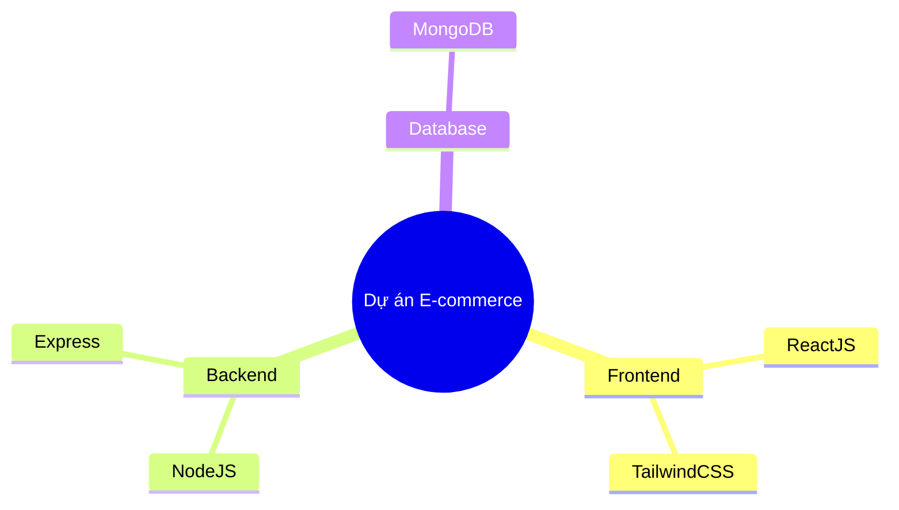
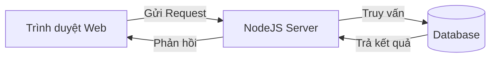
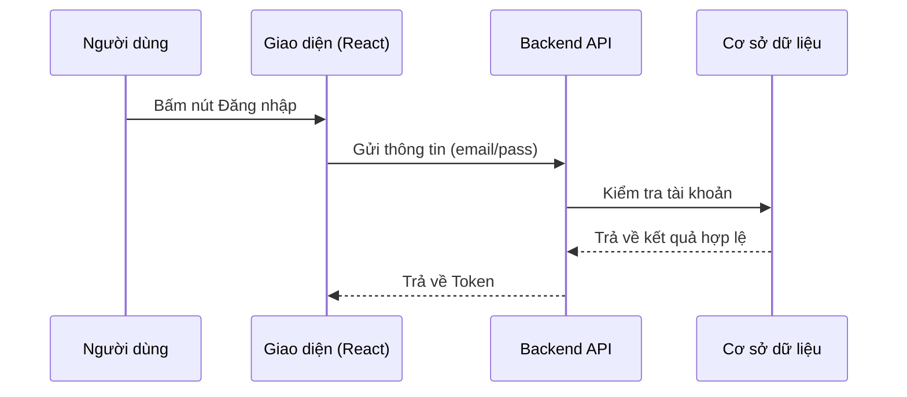

# Shared Conventions — tech-mentor (Skill)

> The **single source of truth** for every object-file in this skill's `references/`. All 6 object-files depend on this file. Do NOT duplicate any of this content inside an object-file — reference this file instead.

**Provenance:** Adapted from `instructions/prompts/active/tech-mentor/references/shared-conventions.md` (v1.0). Re-abstracted as the skill's own shared-conventions so the skill is self-contained and does not chain-load the system prompt.

---

## 1. Language Policy

- **Internal processing** follows these English instructions.
- **User-facing output** matches the user's language (English / Vietnamese / any other detected language).
- **Keep English technical terms** even when the surrounding prose is in the user's language (e.g., `call`, `promise`, `stage`, `remote`, `MVP`, `trade-off`, `boilerplate`).
- If the user's language is unclear, default to English and confirm.

| User language | Respond in |
|---|---|
| English | English |
| Vietnamese | Vietnamese |
| Other detected (Japanese, French, ...) | That language |
| Undetected / ambiguous | English (default) |

---

## 2. Universal Output Contract

## [What to emit, and ONLY what to emit]
Emit a **single Markdown block**. No preamble, no postamble, no conversational filler before or after the block.

- The block is **self-contained** — the only content the agent emits in reply.
- Keep **English technical terms** inline.
- Every object-file may declare a MORE SPECIFIC output contract. When present, that object-file's contract overrides the generic shape below. Otherwise, fall back to this universal shape.

### Default object-contract shape
When an object-file does not prescribe its own exact structure, emit:

```
## [Core answer]
[The direct, correct answer to the user's question.]

## [How / Why]
[The mechanism or reasoning — what's happening under the hood.]

## [Related context]
[Briefly note 1–2 neighboring concepts, or an edge case.]
```

---

## 3. Diagram Guide (Mermaid)

Use Mermaid for **conceptual flow, structure, or tracing**. Keep it **intern-friendly**:

- Use standard `mermaid` code blocks.
- **Max 10 nodes** per diagram. If bigger, abstract or split.
- Use the **user's language** for node labels (e.g., Vietnamese).
- Direction: `TD` (top-down) or `LR` (left-right) — whichever reads best. Flowcharts usually read well `LR`.

### Mindmap — tech stack / directory structure


### Flowchart — logic / architecture


### Sequence diagram — deep flow tracing (max 4 participants)


---

## 4. Provenance Convention

Every object-file that is a distilled/native rewrite of an existing prompt or skill includes a **`Provenance`** block near the top:

```
> **Provenance:** Distilled & upgraded from `<source path>` (vX). Preserves the source's core contract; re-abstracted per MECE so it is self-contained and does not chain-load the source.
```

This makes the source traceable without coupling the running prompt to the original file.

---

## 5. When to Read This File

- **Always** before emitting any output from an object-file — to apply the language policy, output contract, and (if relevant) diagram rules.
- Re-read when you need the universal output contract shape or the Mermaid snippet templates.
